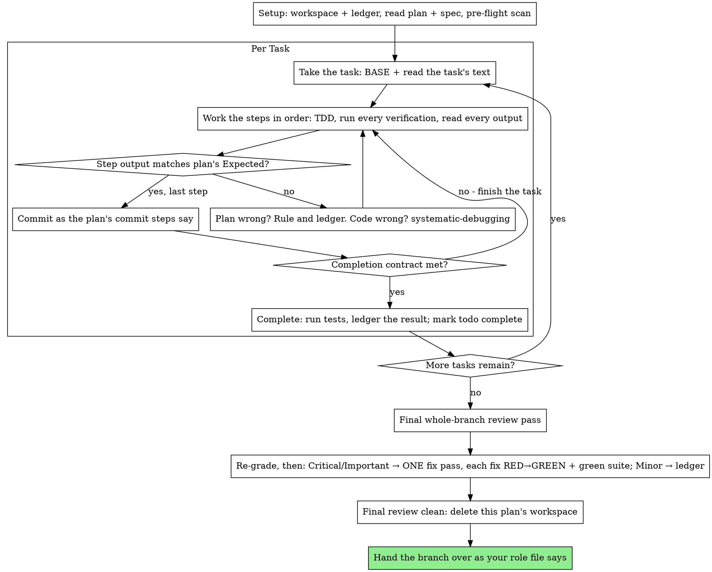

# Executing Plans

Execute the plan yourself, task by task, in this session, with one
review pass over the whole branch at the end.

**How this holds up:** the task's text in the plan is the spec, the ledger
is your memory, TDD is the per-task gate, and the final review pass is the
second look.

**Core principle:** The plan already did the thinking. Execute it exactly,
prove each step with a test you watched fail and then pass, and leave a
record that survives your own forgetting.

**Narration:** between tool calls, narrate at most one short line — the
ledger and the tool results carry the record.

**Continuous execution:** Do not pause to ask your manager "should I
continue?" after every task. Execute all tasks from the plan without
stopping, except where your role file says to stop.

**Rulings, not stalls.** Conflicts, ambiguities, plan defects — decide them.
The spec is the binding authority, the plan is its argument, and your
judgment settles what neither answers. Record every decision in the ledger
as `Ruling: <what you decided> — <why> — <what it costs if wrong>`, and keep
going. Deviating from the plan without a ledgered ruling is a decision made
in secret.

A plan so broken that every path forward is a guess also stops you: send
your manager the question with `send_message` and wait for the reply. What
else needs someone's say before you act is set by your role file, not by
this skill.

## When to Use

- You have an implementation plan to carry out, and the work is yours to
  do in this session.
- Tasks are mostly independent.

A fully specified plan makes execution transcription plus testing. Over a
long plan, later tasks may run on a compacted context — the ledger is what
makes the work recoverable — but the last tasks get the least of you.

## The Process

## Setup

Work in the folder and on the branch your role file gives you. Do not
create worktrees or branches beyond what your role file allows.

Conversation memory does not survive compaction. An executor that loses
its place re-implements tasks whose commits already exist, paid for in
your own context. Track progress in a ledger file, not only in todos.
Harness todos are a live view; the ledger is the record.

- Each plan owns a workspace: the directory
  `<repo-root>/.superpowers/sdd/<plan-basename>/`, home to every
  artifact for THIS plan: ledger, test logs, review notes. Create it if it
  is missing, and keep it out of git: if `.superpowers/sdd/.gitignore`
  does not exist, create it holding the single line `*`. Another plan's
  directory is never yours to read or write.
- Check for this plan's ledger at `<workspace>/progress.md`. If its first
  line names your plan file, tasks with a `Task <N>: complete` line are
  DONE — do not redo them; resume at the first task without one. Their
  commits exist in git even when your context no longer remembers making
  them: after compaction, trust the ledger and `git log` over your own
  recollection. A ledger whose first line names a different plan file is
  another plan's progress: leave it and start your own, fresh.
- Create the ledger with its identity as the first line:
  `# SDD ledger — plan: <plan file path>`.
- `git clean -fdx` will destroy the workspace (it's git-ignored scratch);
  if that happens, recover from `git log`.

Read the plan once, note its context and Global Constraints, and create a
todo per task. If the plan names a Spec, read that too: the spec is the
authority the plan argues from, and conflicts inside the plan resolve
against it. A plan with no reachable spec gets a ledger note saying so —
rulings made without one are provisional.

**REQUIRED SUB-SKILL:** load the `test-driven-development` skill now,
before Task 1. It governs every step of every task below; a plan whose
steps already say "write the failing test first" does not exempt you
from reading it.

Before Task 1, scan the plan for conflicts between tasks. The plan's
Interfaces blocks tell you where to look: for every task that consumes
what an earlier task produces, one ledger row — the two tasks, what one
produces against what the other consumes, and what you found. Tasks that
share nothing get no row; a plan whose tasks share nothing gets the single
line `Pre-flight: no shared interfaces`. Rule on each conflict a row
surfaces with the spec as the binding authority, record the ruling beside
its row, and start Task 1. Each task's own text is checked when you take
the task, not here.

## The Task Loop

Everything you print, and every tool result, stays resident in your
context for the rest of the session. Redirect long test output to a file
in the workspace and read its tail; read the task's own text, not the
whole plan again.

### 1. Take the task

- Record BASE, the commit the task's range is cut from:
  `git rev-parse HEAD` in the working tree you're executing in.
- Read the task's text in the plan for every task, including ones you
  remember from setup: what you remember is a summary, the task's text
  has the exact values, signatures, and test cases.
- Mark the task's todo in_progress.

Every tool call is a turn that re-reads your whole context. Bookkeeping
rides along with work — a ledger append in the same call as the commit,
never in a call of its own.

### 2. Work the steps

The plan's steps are already in RED-GREEN order; follow them in that
order under the `test-driven-development` skill, loaded at setup. A test
step's code is written first and run first. Watching it fail is a step,
not a formality — a test that passes before the implementation exists is
a finding about the test.

Every step that runs a command has an `Expected:` line. Run the command,
read its output, and compare. Three outcomes:

- **Matches.** Next step.
- **The code is wrong.** Use the `systematic-debugging` skill. Find the
  cause; never patch the symptom to make the step's output match.
- **The plan is wrong** — a step contradicts the spec, an interface from an
  earlier task doesn't match what this task consumes, a command that
  cannot work. Rule on the smallest change that satisfies the spec, ledger
  it as `Task <N>: Ruling: <finding> — <what you decided and why>`, and
  continue. The ruling is carried, not remembered: later tasks that touch
  the same interface read it from the ledger.

Commit as the plan's commit steps say. A task that spans several commits
is fine; BASE is what the review range is cut from, never `HEAD~1`.

### 3. The completion contract

Before a task's ledger line, all of the following are true, with evidence
in this session — not inferred from the diff looking right:

- Every test the task names exists and ran in this task, and you read
  the output.
- The final test run for the task passed — the run in step 4 is that
  run, and its command and result go into the ledger line.
- Every `Expected:` line in the task was compared against real output.
- Every deviation from the task's text has a `Ruling:` line in the ledger.

**REQUIRED SUB-SKILL:** the `verification-before-completion` skill governs
the claim. If any item is missing, the task is not complete: finish it.

### 4. Complete the task

Run the test command the task names for the whole task, from the working
tree you're executing in, with its full output redirected to
`<workspace>/task-<N>-tests.log`, and read the log's tail. Only if the
command succeeded, append the completion line to the ledger
(`<workspace>/progress.md`), creating the ledger with its identity line
first if it does not exist yet:

`Task <N>: complete (commits <base7>..<head7>, tests: <command> → <result>)`

`<base7>` and `<head7>` are the first seven characters of BASE and of
`git rev-parse HEAD`; `<result>` is the last non-empty line of the log.
A failing run records nothing; the task is not complete. When it records,
mark the todo complete and take the next task.

## Final Review

Find MERGE_BASE, the commit the branch started from (e.g.
`git merge-base main HEAD`), and review the whole range with
`git diff --stat MERGE_BASE..HEAD` and `git diff MERGE_BASE..HEAD`, as a
separate pass after the last task's ledger line. Check it against the plan
and the spec: does it match them, is anything planned missing, do the
tests check real behavior, and does each item in the plan's Review Focus
section (if it has one) have a test? List every behavior you considered
and set aside as outside the plan or spec, one line each, with the
reason. Write `Final review: self-review` to the ledger, and say so in
your final message: a self-review by the author is weaker than a fresh
reviewer. Any further review happens as your role file says.

Sort the findings before you act on any of them. Grade each as Critical,
Important or Minor. Your set-aside list counts too: every line there is a
ruling you make and ledger, exactly like
a plan conflict — `Final: Ruling: <behavior you set aside> —
<what a reasonable person using this software gets, and why that stands
or why it is now a finding> — <cost if wrong>`. Re-grade first, by effect: the
spec is a vision document, and a finding's grade is what a reasonable
person using this software gets if it ships, not whether the spec names
the input that triggers it — a finding set at Minor because the spec was
silent has graded the spec, not the effect. Then:

- **Critical and Important** enter the fix pass.
- **Minor** goes to the ledger as `Final: minor (deferred): <one-liner>`
  and to your final message under "Deferred minors". Minors never enter
  the fix pass, and never become rulings — a ruling is a decision about a
  conflict, not a note that you declined a polish suggestion.

Fix the Critical and Important findings yourself — you are the
implementer here — in ONE pass. Each fix is verified by TDD: write the
test that reproduces the finding, watch it
fail, make it pass, then run the whole suite. Record each in the ledger as
`Final: fixed <finding> — <test name> RED→GREEN, suite <N>/<N>`. A fix
without a test that failed first is not verified; a suite that is not
green after the pass means the pass is not over.

A finding you decide not to fix is a ruling — `Final: Ruling: <finding> —
<why the code stands> — <cost if wrong>` — and reaches your manager
in the rulings list. There is no second fix pass.

## Finish

Before you delete anything, collect every ledger line containing
`Ruling:` into your final message under "Rulings I made", in the order you
made them, each with what it costs if wrong, and every `minor (deferred)`
line under "Deferred minors". Both lists are exhaustive. Your final
message (send it to your manager with `send_message`) is the only place
the decisions you took on your manager's behalf — and the findings you
chose not to act on — reach them.

When the final review is clean and its fixes are committed, delete this
plan's workspace directory — the git history is the record now. Sibling
directories belong to other plans; leave them alone.

Then hand the branch over as your role file says.

## Common Rationalizations

| Excuse | Reality |
|--------|---------|
| "I remember what Task N says" | You remember a summary. The task's text has the exact values. Read it. |
| "The plan's code is right, skip watching the test fail" | A test you never saw fail proves nothing. It is one step. Run it. |
| "I'll run the full suite at the end instead of per step" | Per-step runs are how you learn which step broke it. The end-of-task run is the contract, not a substitute. |
| "The plan is wrong here, I'll just do the right thing" | Do the right thing and ledger the ruling. Unledgered deviation is a decision made in secret. |
| "I'll write the ledger lines after a few tasks" | Compaction does not wait for a convenient moment. One line per task, in the same message as the commit. |
| "Let me check in before the next task" | Progress prompts spend your manager's time. Only a broken plan, or what your role file names, stops you. |
| "I read my own diff as I went; the final review pass is redundant" | Task-by-task reading misses what only the whole branch shows. Do the pass. |
| "Tests should pass, the change was trivial" | "Should" is not evidence. The contract requires the command and its output. |
| "It looked Minor on first read, so it's Minor" | That grade may be the spec's silence. Grade what the person gets. Re-grade, then gate. |
| "The fix is obvious, no need for a failing test first" | The failing test is the only proof the finding was real and is now gone. Without it you have a diff and a hope. |
| "I'll fix the minors too while I'm in there" | Every minor you fix is a test, a fix, and a suite run your manager did not ask for. Ledger them; your manager decides. |
